# SAANS Architecture and System Specification

## High-Level System Architecture

```mermaid
flowchart TD
    subgraph Browser ["Client (Browser - Next.js)"]
        UI["Saans Web App (TypeScript Strict)"]
        LocalStorage[("localStorage (Household Profile & Local History)")]
        LocalVoice["Web Speech API (en-IN, hi-IN, mr-IN)"]
        OfflineCache["Service Worker & Fixture Cache"]
        
        UI <--> LocalStorage
        UI <--> LocalVoice
        UI <--> OfflineCache
    end

    subgraph Edge ["Network Boundary (Strict CORS, Rate Limiting, CSP)"]
        API_GW["FastAPI Gateway (/api/v1)"]
    end

    subgraph Backend ["Server (apps/api - Python 3.12/3.13)"]
        RouterAir["/air (Hourly Forecast & CPCB AQI)"]
        RouterPlan["/plan (Dynamic Scheduler)"]
        RouterSim["/simulate (Intervention Deltas)"]
        RouterChat["/chat (SSE Streaming & Tool Execution)"]
        RouterCommunity["/community/advisory (Card Generator)"]
        
        subgraph Engine ["Pure-Python Exposure Engine (Deterministic Math)"]
            CPCBAQI["cpcb_aqi.py (Breakpoints)"]
            MassBalance["mass_balance.py (Indoor Concentration)"]
            DoseCalc["dose.py (Inhaled Dose & Breath Budget)"]
            Scheduler["scheduler.py (Exposure-Minimizing Optimizer)"]
            Sustainability["sustainability.py (Emissions Avoided)"]
            IDW["idw.py (Station Inverse-Distance Weighting)"]
            Constants["constants.py (Locked Coefficients)"]
        end
        
        subgraph AI_Layer ["AI & Safety Layer"]
            SafetyGuards["safety.py (Red-line Medical Intercept & Injection Filter)"]
            Corpus["Local BM25 / Embedding Index (Curated Chunks)"]
            LLMClient["Provider-Agnostic LLM / MockLLM"]
            Traceability["traceability.py (Number Verification Guard)"]
        end
        
        subgraph Storage ["Server Storage (Zero Personal Data)"]
            SQLiteCache[("SQLite Cache (15-min Air TTL & Pre-built Embeddings)")]
        end
    end

    subgraph Upstream ["External Services (Allowlist Only)"]
        OpenMeteo["Open-Meteo Air Quality & Geocoding API"]
        GovStations["OpenAQ / CPCB Stations"]
        OSRM["OpenRouteService / OSRM"]
    end

    UI -->|"POST (Household Profile in Payload)"| API_GW
    API_GW --> RouterAir
    API_GW --> RouterPlan
    API_GW --> RouterSim
    API_GW --> RouterChat
    API_GW --> RouterCommunity

    RouterAir --> CPCBAQI
    RouterAir --> SQLiteCache
    SQLiteCache -.->|"Cache Miss"| OpenMeteo

    RouterPlan --> Scheduler
    RouterPlan --> DoseCalc
    RouterPlan --> MassBalance

    RouterSim --> MassBalance
    RouterSim --> DoseCalc
    RouterSim --> Sustainability

    RouterChat --> SafetyGuards
    SafetyGuards -->|"Static Medical Refusal if symptoms"| UI
    SafetyGuards --> LLMClient
    LLMClient -->|"Tool Calls"| Engine
    LLMClient -->|"Context Query"| Corpus
    LLMClient --> Traceability
    Traceability -->|"Verified Stream"| UI

    RouterCommunity --> CPCBAQI
```

---

## Architectural Principles

1. **The LLM Never Does The Math:**
   All numeric computations (inhalation dose, AQI linear sub-indexes, indoor ventilation concentration, Berkeley Earth cigarette-equivalents, schedule optimization, and emission factors) are performed exclusively within `apps/api/engine`. The LLM only receives tool outputs, personalizes language, and narratively explains recommendations. Traceability verification ensures no hallucinated numbers reach the user.

2. **Privacy by Design & Zero Server Persistence:**
   The user's household profile (ages, health flags, commute modes, home characteristics) resides strictly within client-side `localStorage`. It is transmitted as transient request data and is never written to disk, database, or server logs.

3. **Deterministic Offline Capability:**
   The system ships with verified, labeled offline fixture snapshots for Delhi, Ghaziabad, and Lucknow. When upstream APIs are unavailable or network access is restricted, the offline fixtures automatically engage with a mandatory "Stale or Sample Data" warning banner.

4. **Strict Token Architecture:**
   The visual theme represents an editorial, field-instrument aesthetic with locked design tokens (`#F3EFE6` paper, `#17181A` ink, and exact CPCB palette). No generic gradients, no glassmorphism, and no decorative AI tropes.
